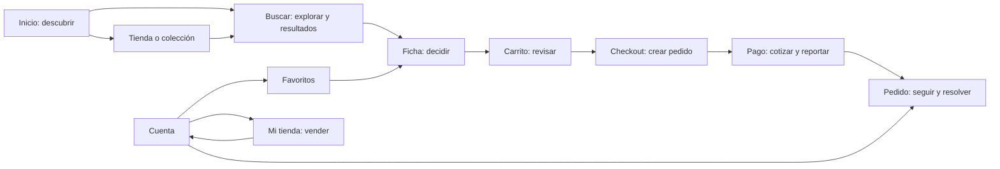
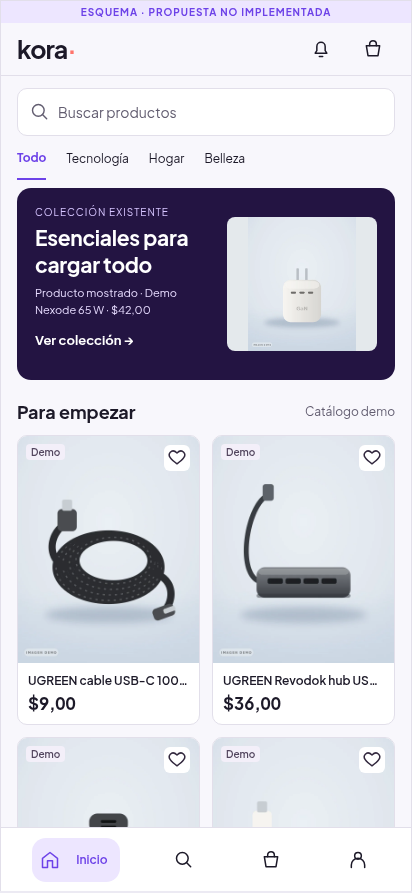

# HAYAZGO — arquitectura de experiencia V2

**Etapa 0 · 12 de octubre de 2026 · propuesta para Oliver.** Dirección y esquemas documentales; todavía no implementados. No autoriza refactorización ni publicación. Electric Violet y el nombre provisional del código se conservan.

## 1. Diagnóstico y alcance de la evidencia

El problema principal es la ausencia de una jerarquía común entre descubrimiento, comparación y operación. Las funciones existen, pero Inicio acumula destinos y resultados, el catálogo repite contexto y la compra no explica siempre la diferencia entre crear un pedido y reportar un pago. Ajustar el aspecto de cada caja no corrige esa arquitectura.

| Problema observado | Consecuencia | Decisión estructural |
|---|---|---|
| Inicio concatena campañas, historial, recomendaciones, colecciones, tiendas y un feed continuo | La portada compite con Buscar; demasiados comienzos y poca prioridad editorial | Portada finita: una apertura editorial, comparación inicial y rutas claras hacia el catálogo |
| «Ver todas» las tiendas abre productos; recomendaciones llevan a un catálogo genérico | El destino contradice la promesa del control | Enlaces específicos existentes; retirar el CTA engañoso si falta el destino |
| Categoría, contador, pestaña y resumen pueden repetir el mismo contexto | Se ocupan franjas persistentes sin aportar decisiones nuevas | Una sola identificación del contexto; controles según exploración o consulta |
| Una fotografía muy alta domina la primera vista de la ficha | Precio y variantes aparecen; vendedor y condiciones quedan lejos de la decisión | Galería contenida en el presupuesto de la primera vista, información comercial agrupada |
| Encargo promete universalmente 50 % de anticipo; los planes dependen del carrito completo | Expectativa comercial que puede incumplirse al combinar tiendas/modalidades | No prometer planes antes de la elegibilidad del servidor |
| Pago tiene encabezado «Confirma tu pago», aunque el CTA ya aclara «enviar para verificar» | El encabezado contradice la semántica correcta del CTA y de su aviso | Separar elección, cotización, reporte y verificación |
| Componentes editoriales, resultados y operaciones comparten demasiado lenguaje de tarjetas | No se distingue explorar de resolver una tarea | Anatomía comercial común, variantes de densidad y función |

**Base real:** código móvil de `d945797`, continuidad en `8096e3f`, capturas web actuales de visitante a 412 × 892, claro/oscuro, y evaluación física de Oliver relatada en sus instrucciones. La publicación previa y sus pruebas son antecedentes, no prueba de la calidad de esta propuesta.

**Límites:** sin teléfono/emulador Android local. Checkout y pago autenticados no se recorrieron: las capturas muestran sus barreras de acceso; sus composiciones actuales se analizan por código. No se crearon usuarios, pedidos, cotizaciones ni pagos. Servicios locales de lectura con transacciones revertidas; carrito de visitante en perfil temporal. Esquemas propuestos no equivalen a pantallas implementadas ni a pruebas de persistencia.

Las siete propuestas, las capturas y las fuentes están en el [tablero comparativo](diseno-v2/propuestas.html) y en [Evidencia y revisión](diseno-v2/EVIDENCIA_Y_REVISION.md). El documento permanece en revisión hasta cerrar la segunda ronda independiente. Ninguna figura modifica la app.

## 2. Principios y reglas del sistema

1. **Producto y compromiso comercial primero.** Fotografía, precio aplicable, variante, disponibilidad y consecuencia del CTA anteceden a decoración y mensajes genéricos de confianza.
2. **Una pantalla, una decisión principal.** Inicio inspira y orienta; Buscar compara; la ficha decide; carrito revisa; checkout crea el pedido; pago cotiza y reporta; seguimiento explica la próxima acción.
3. **Complejidad progresiva, capacidades intactas.** Resúmenes editables y hojas secundarias sustituyen controles persistentes redundantes. No se eliminan filtros, calendarios, reclamos o historial.
4. **Contexto estable.** Volver conserva consulta, alcance, filtros, orden y posición; limpiar filtros no abandona una tienda o colección.
5. **Identidad por estructura y acento.** Electric Violet dirige selección, navegación y acción principal; no colorea cada superficie. Fotografía y marca editorial aportan personalidad.
6. **Estado antes que animación.** Carga, guardado, error recuperable y verificación deben entenderse sin movimiento. Movimiento reducido elimina transiciones prescindibles.
7. **Verdad comercial.** Demo visible, inventario y capacidades reales, sin promociones, conteos, insignias, reseñas ni recomendaciones inventadas.

## 3. Mapa de experiencias y navegación

Se conservan cuatro pestañas: **Inicio · Buscar · Carrito · Cuenta**. Carrito mantiene acceso constante. Mi tienda es un espacio dentro de Cuenta con permisos reales; no introduce una quinta pestaña ni obliga a abandonar el rol comprador. Pedidos y Favoritos permanecen en Cuenta, productos y notificaciones contextualizadas.

| Experiencia | Entrada y contexto | Estructura y densidad | Salida y continuidad |
|---|---|---|---|
| A. Descubrir | Inicio; colección; tienda | Editorial finita, módulos elegidos, comparación inicial | Catálogo con alcance explícito; ficha; vuelta a la posición de origen |
| B. Encontrar y decidir | Buscar general, consulta, categoría, tienda o colección | Cuadrícula comparativa; ficha con decisión y condiciones | Añadir conserva ficha; Comprar abre carrito sin duplicar unidades |
| C. Comprar | Carrito; dirección; entregas; planes elegibles | Filas operativas y revisión progresiva | Pedido creado explícitamente; método y cotización posteriores |
| D. Seguir y resolver | Cuenta, notificación, pago pendiente | Próxima acción, entrega, historial expandible, soporte/reclamo | Reanudar pago o resolver un pedido existente, sin recrearlo |
| E. Vender | Cuenta → Mi tienda; tienda seleccionada | Trabajo pendiente, catálogo operativo, entregas, configuración | Compra y gestión conviven; panel avanzado sigue disponible |

**No se crean rutas paralelas «Resultados» y «Buscar».** Son estados del `Catalog` existente. `/explore`, `/catalog` y `/store/[slug]` conservan sus alcances actuales; `/tienda` sigue siendo alias público. El diagrama expresa experiencias, no una migración de rutas.

## 4. Qué conservar, fusionar, simplificar y reconstruir

| Decisión | Elementos | Justificación |
|---|---|---|
| Conservar | Cuatro pestañas, roles/RLS, RPC existentes, variantes, favorito accesible, un precio principal, catálogo paginado, navegación de tienda/colección, calendario, idempotencia | Son capacidades operativas; no rehacer VEN-01A ni el último rediseño de tarjetas |
| Fusionar visualmente | Identificación del contexto de catálogo; información decisiva de ficha; revisión de checkout | Reducir repetición y distancia entre datos que se deciden juntos, sin fusionar contratos financieros |
| Simplificar | Carruseles simultáneos, sobreencabezados repetidos, superficies innecesarias, resumen de filtros duplicado | Un módulo debe ofrecer una tarea o un destino distinto |
| Retirar | «Ver todas» tiendas → productos; promesas universales de anticipo; indicadores de carrusel cuando hay una sola pieza editorial | Son promesas incorrectas o controles sin función, no funcionalidades comerciales |
| Reconstruir composición | Portada y secuencia de módulos; estados contextuales del catálogo; bloque decisorio de ficha; presentación progresiva de checkout/pago | La mejora debe percibirse en qué se ve primero, qué se decide y cómo continúa el recorrido |

No se retira el feed: su exploración continua vive en Buscar; Inicio conserva una muestra finita y acceso «Explorar catálogo». Colecciones y tiendas siguen accesibles. No se exige una página «Todas las tiendas» inexistente: las tiendas del módulo abren su página real; un directorio será iniciativa separada si se aprueba.

## 5. Nueva portada: decisión recomendada

**Una apertura editorial de ancho útil completo, sin carrusel automático.** Elegir la primera colección `feature` válida en el orden del backend. Mostrar un producto existente en la colección, fotografía íntegra, nombre y precio demo rotulado cuando corresponda. El módulo lleva a la **colección identificada**: un solo destino comercial, CTA «Ver colección». El precio ilustra ese producto, no el precio de toda la colección. El detalle de producto se abre desde sus tarjetas en la colección; no colocar dos enlaces ambiguos dentro de un mismo hero.

Los demás destacados no desaparecen: pasan al bloque de colecciones con nombre y destino real. Se elimina la necesidad de puntos de paginación en esta apertura. Si una futura campaña exige paginar, se revisará como variante con indicador integrado y navegación manual; no se activa por defecto.

**Secuencia normal:**

1. Marca compacta y notificaciones reales; acceso rápido al carrito actual durante la primera intervención, sin añadir duplicados nuevos.
2. Buscador visible, con destino Buscar y consulta conservada.
3. Categorías compactas: nombre y miniatura discreta, no otra hilera de grandes círculos protagonistas.
4. Una pieza editorial de colección real.
5. «Para ti» o «Para empezar», según datos reales: cuatro productos en 2 × 2, primera comparación útil.
6. «Retoma» solo con historial real: fila breve, estado de disponibilidad excepcional visible. Sin historial no ocupa espacio.
7. Colecciones agrupadas: dos visibles y acceso al resto existente, sin carruseles repetidos con la misma gramática.
8. Tiendas con nombre y enlace real individual; sin CTA a un catálogo que no es de tiendas.
9. Muestra finita de populares y «Explorar catálogo» con el orden existente pertinente.

**Fallback:** sin colección editorial válida, los productos ocupan inmediatamente ese lugar. Sin personalización se usa la respuesta real de inicio, sin afirmar que se conoce al comprador. Sin catálogo se muestra el estado vacío actual con salida útil; no se fabrica promoción. Deduplicar la apertura y la primera comparación por producto; Retoma puede repetir porque representa continuidad. Colecciones nombradas conservan su identidad aunque compartan productos.

**Presupuesto, no altura rígida:** a 412 × 892 y tamaño de fuente normal, cabecera funcional aproximadamente 44 + 48 + 44 px, editorial 172–200 px y comienzo de comparación antes del primer scroll largo. Estos números son objetivos del esquema, no mediciones de Android. A 320 px o fuente ampliada se refluye y crece; no se recorta texto para cumplir una cuota visual.

Primera mejora significativa recomendada tras aprobación: esta composición de Inicio usando `home_feed`, categorías, colecciones, productos y tiendas existentes. No requiere modificar precio, pagos, permisos o Supabase.

## 6. Buscar y resultados: arquitectura contextual

| Estado | Visible antes del catálogo | Secundario / comportamiento |
|---|---|---|
| Exploración general | Campo de búsqueda; categorías discretas; una fila de estado con Filtrar y Ordenar | Filtros secundarios en hoja; no otra barra de cápsulas |
| Consulta escrita | Consulta editable y una fila «Resultados para…» con controles | Categorías completas dejan de persistir; seleccionar categoría desde filtros conserva consulta |
| Categoría elegida | Un solo nombre de categoría y controles | No repetirlo como contador, pestaña y chip simultáneamente |
| Tienda / colección | Nombre y alcance real, buscador dentro de ese alcance | Restablecer conserva el alcance bloqueado; salida explícita para Buscar general |
| Filtros activos | Resumen único, compacto, editable y limpiable | Cantidad de filtros activos no se confunde con cantidad de productos |
| Sin resultados | Consulta/alcance, motivo y recuperación precisa | Quitar filtro o editar búsqueda; no limpiar la tienda silenciosamente |

**Filtrar y Ordenar siguen siendo controles distintos, agrupados en la misma línea de herramientas.** Orden actual visible por texto breve; cambio anunciado y selección persistida. Filtros con borrador: abrir no aplica; cancelar conserva; aplicar confirma conjunto. Todas las capacidades actuales —precio, disponibilidad, categoría y orden— permanecen.

El buscador y la línea de herramientas conservan contexto al desplazarse. La fila completa de categorías no queda permanentemente encima de resultados escritos. No sumar otra cabecera grande «Buscar». El contador representa **productos cargados** y «+» si hay más página; el RPC no da un total exacto ni facetas. No mostrar «124 resultados» ni conteos por filtro sin contrato nuevo.

Volver desde ficha restaura filtros, alcance y posición. Carga inicial reserva la estructura de cuadrícula; refetch conserva resultados y anuncia actualización. Error no vacía datos ya disponibles ni reinicia la consulta. Teclado puede enfocar buscar, abrir hoja, recorrer opciones, aplicar y volver al control de origen.

## 7. Sistema de presentación de productos y ficha

Una anatomía comercial, **cinco variantes funcionales**, no una tarjeta universal:

| Variante | Información y comportamiento |
|---|---|
| Editorial | Fotografía y producto real dentro de una colección identificada; CTA de colección inequívoco; demo explícito |
| Resultados / recomendaciones | Foto 4:5 conservada, nombre una línea, precio principal, favoritos 18–20 visual / 44 táctil; oferta y disponibilidad excepcional sin ruido redundante |
| Retoma | Miniatura y nombre/precio compactos; agotado, encargo o indisponible visible; favorito solo si aporta una acción sin competir |
| Carrito | Miniatura, variante, cantidad editable, disponibilidad, importe del servidor en cuenta, precio referencial local como visitante, y recuperación del error; agrupación operativa |
| Revisión / entrega | Producto y cantidad en la entrega correcta; variante legible; sin controles de exploración o favoritos |

No reconstruir por estética la tarjeta de `d945797`: radio 10, superficie integrada, corazón discreto y objetivo 44 ya son una base coherente. El siguiente cambio responde al **contexto y datos**, no a aumentar sombras o radios.

Fotografías de catálogo heterogéneas: `contain` para conservar el SKU; fondo neutro coherente con cada tema. Recorte editorial solo si la imagen aprobada permite reconocer el producto. No generar ni retocar fotografías para simular evidencia. Descuento únicamente con precio anterior válido. Demo no equivale a oferta; no inventar ventas, urgencia, estrellas o verificación del vendedor.

**Ficha:** galería accesible, con paginación y fotos existentes, contenida aproximadamente en 40–45 % de la altura útil inicial en pantalla estándar; proporción real sin deformar, más altura cuando sea necesario. Ampliación/zoom no existe hoy: queda fuera del primer incremento, no se promete como capacidad conservada. Debajo, un bloque decisorio: nombre, precio de variante seleccionada, disponibilidad excepcional, variantes, vendedor y entrega disponible. Descripción, características, opiniones reales y relacionados siguen a continuación. Conservar Compartir y Favoritos en la cabecera; selector Cantidad junto a variantes. CTA fijo: Disponible → Comprar; Por encargo → Encargar; En camino/Reservable → Reservar; Agotado → Avisarme o cancelar alerta según estado existente. Añadir sigue donde la disponibilidad lo permite. Ninguna acción se pierde; no cubrir contenido ni teclado.

No afirmar «Desde» sin un mínimo comprable verificable. No prometer cuota o anticipo desde la modalidad del SKU: la elegibilidad se confirma con el carrito completo. Reservar y Encargar usan las reglas existentes; no introducen apartados gratuitos ni garantías nuevas.

## 8. Recorrido de compra: decisiones y compromisos

**Carrito:** producto, variante, cantidad, disponibilidad e importe forman una fila operativa. Grupos de entrega por **tienda + modalidad + disponible/en camino**, según servidor. Una tienda puede originar varias entregas. Mostrar los problemas junto al producto y una acción concreta; subtotal no se presenta como total final. Visitante conserva su carrito local existente, con precios referenciales guardados en el dispositivo y revalidación al iniciar sesión; se identifica antes de la compra; no se inventa checkout anónimo.

**Checkout:** mantener una ruta, con cuatro secciones progresivas: dirección → entregas → plan elegible → revisión. Una sección activa, anteriores resumidas/editables. No agregar pasos o formularios obligatorios. Cambiar dirección invalida la selección de envío y obliga a revisar el nuevo preview; confirmar queda deshabilitado mientras cambia. El calendario real siempre es accesible. Mostrar costo y plazo por entrega, total y obligaciones del servidor, y qué ocurre al confirmar.

**Confirmar pedido crea el pedido.** `place_order` descuenta inventario, vacía el carrito y crea obligaciones/entregas. El CTA no se sustituye por un ambiguo «Continuar» o «Pagar». La pantalla posterior permite ver el pedido y reanudar el pago del mismo `orderId`, dentro de la vigencia que indique el servidor; no promete reservarlo indefinidamente. La salida visible «Ver pedido» evita depender exclusivamente de Atrás. Atrás no revierte el pedido ni recrea el carrito automáticamente.

**Pago:** método → cotización exacta y vigente → instrucciones y reporte → verificación. Antes de cotizar, valores indicativos rotulados como aproximados. Después, monto, moneda, comisión, vigencia y destinatario de la cotización del servidor. Cuando hay conversión, mostrar fecha/hora de la tasa aplicada (`rate_observed_at`), distinta de emisión (`issued_at`) y vencimiento de la cotización (`expires_at`); emitir una cotización nueva no rejuvenece su tasa. El encabezado pasa a «Reportar pago» en coherencia con el CTA actual que ya dice enviar para verificar. «Reportar pago» envía el reporte con referencia y/o comprobante según los requisitos reales del método; efectivo no exige ambos y no hay captura obligatoria universal. No marca el pedido pagado. Mientras existe un reporte en `pending_verification` o un intento en `processing`, se bloquea una nueva cotización o reporte y se ofrece retomar el intento/pedido existente. Un rechazo muestra motivo y deuda real, con recuperación permitida. Solo se ofrecen métodos habilitados y elegibles; proveedores preparados siguen inactivos. La verificación depende de revisión autorizada o evento firmado. El regreso del proveedor tampoco equivale a pago recibido.

Cuotas dependen de todo el carrito. No prometer «50 % y el resto cuando llegue» si el calendario usa fechas desde la creación del pedido. Mostrar el calendario confirmado. Los saldos USD y sus conversiones posteriores siguen el contrato real: no congelar VES en carrito, ni reutilizar silenciosamente una tasa vencida.

**Seguimiento:** próxima acción primero —pagar, esperar verificación, seguir entrega, resolver incidencia—; cronología e historial financiero accesibles mediante expansión. Reclamos y soporte mantienen sus rutas y permisos. La interfaz no garantiza reembolso automático.

**Tasas:** la corrección BCV sigue como prioridad crítica independiente. La nueva interfaz no expone nombres técnicos de adaptadores; conserva fecha/hora de la tasa aplicada (`rate_observed_at`) y procedencia verificable mediante lenguaje comprensible, sin convertir un identificador interno en una certificación oficial. «Tasa oficial BCV» requiere procedencia oficial verificable; si no está confirmada, describir honestamente la conversión o bloquear el método según política existente. Etapa 0 no cambia fuente, cálculo ni disponibilidad.

## 9. Sistema visual y patrones compartidos

| Regla | Decisión y razón |
|---|---|
| Tipografía | Plus Jakarta Sans existente; nombre comercial compacto, precio claramente superior al nombre en cuadrícula, títulos de sección sin sobreencabezado repetido. Regla futura: no aplicar tracking negativo a texto pequeño; no obliga a retocar la tarjeta reciente ni los tokens globales en el primer bloque. Probar cifras, acentos y truncamiento reales |
| Espaciado | Base existente de 4 px; margen exterior 16 en móvil estándar, separación de cuadrícula 12; distancia corta dentro de una decisión, 24 entre tareas distintas. A 320 px y fuente grande refluye antes de reducir objetivo táctil |
| Superficies | Fondo de página, delimitación operativa y selección semántica; no envolver cada encabezado y fila en una tarjeta. Acento editorial violeta y selección suave conservan identidad |
| Radios | 10 en producto, menor en miniatura, mayor en hoja; forma según función. Cápsulas reservadas para estado breve/selección que lo necesite, no para todos los controles |
| Cuadrícula | Dos columnas de comparación cuando precio/nombre siguen legibles; ancho mayor ajusta columnas; fuente ampliada puede pasar a una. No forzar dos columnas con texto cortado ilegible |
| Navegación | Cuatro pestañas actuales; expansión breve comunica selección; etiquetas accesibles aun con iconos contraídos. Acciones contextuales usan stack y regreso al origen |
| Hojas | Filtros con borrador, selección, confirmación importante; foco inicial/retorno, cierre por Atrás/Escape, scroll interno y acciones fuera del teclado |
| Feedback | Guardando impide duplicado y conserva contenido; error junto a tarea con reintento; confirmación solo tras persistencia. Carga inicial y refetch tienen comportamientos distintos |
| Movimiento | Transición breve de estado, respuesta a favorito y progreso; sin carrusel automático. Movimiento reducido suprime desplazamientos y escalas innecesarias; selección comprensible sin animación |
| Claro / oscuro | Tokens semánticos actuales, contraste de texto ≥4,5:1 y controles ≥3:1 donde corresponde; foto y etiquetas se evalúan juntas, sin círculos oscuros dominantes sobre producto |
| Accesibilidad | Objetivos ≥44 × 44, foco visible, nombres/estado de controles, anuncios útiles, orden de lectura, teclado web, 320 px, texto ampliado y sin contenido tapado por barras |

Estas son especificaciones propuestas. El contraste real y el reflow de la aplicación se comprobarán al implementar cada incremento; el render de un esquema no certifica accesibilidad ni rendimiento nativo.

Componentes a compartir: encabezado/contexto de catálogo, selector con borrador, estado recuperable, fila comercial, resumen editable, barra de acción, estado de pedido/pago y anatomía de producto. Las variantes editoriales y operativas conservan distintas densidades. Reutilizar `Catalog`, `ProductCard`, `MiniProductCard`, `RadioRow`, `Sheet`, `BottomBar` y componentes existentes antes de crear equivalentes.

## 10. Investigación y adecuación comercial

No se pudo verificar la interfaz actual de Amazon, Mercado Libre o SHEIN ni leer HIG/Baymard: los seis intentos de fuentes públicas recibieron **Tunnel 403** en este entorno. Lo siguiente es una evaluación de patrones conocidos como **heurísticas profesionales**, no una investigación externa comprobada.

| Patrón / referencia orientativa | Problema, beneficio y coste | Decisión para HAYAZGO |
|---|---|---|
| Búsqueda prominente, asociada a Amazon / Mercado Libre | Acceso rápido a intención explícita; demasiadas herramientas persistentes consumen catálogo | Adoptar búsqueda prominente y contexto; limitar franjas simultáneas |
| Información de entrega y vendedor en la decisión, asociada a Mercado Libre | Reduce incertidumbre; puede saturar tarjetas y exige datos por dirección | Adoptar en ficha/checkout cuando existe dato; no fabricar ETA por domicilio en resultados |
| Descubrimiento editorial, asociado a SHEIN | Orienta exploración; sobreabundancia, urgencia y promociones pueden distraer | Una apertura y colecciones reales; rechazar presión ficticia y banners acumulados |
| Catálogo comparativo denso, común en grandes marketplaces | Permite comparar más productos; puede reducir legibilidad y objetivos táctiles | Dos columnas con jerarquía comercial, excepción por reflow; no miniaturización indiscriminada |
| Progresión, claridad y retorno, principios de interacción Apple | Explica decisiones y conserva control; esconder demasiado puede aumentar pasos | Resúmenes editables y hojas secundarias; conservar acciones críticas visibles y movimiento reducido |

Conservar el formulario venezolano existente: estado, ciudad y teléfono obligatorios; municipio, referencia y cédula/RIF adicionales opcionales. No imponer un código postal extranjero; encargo y reserva no son disponibilidad inmediata; múltiples vendedores no son una única entrega; monedas no son totales intercambiables; reporte manual no es verificación. Estas condiciones gobiernan la adopción de patrones.

## 11. Plan progresivo y aceptación por entrega

Cada incremento es un bloque manejable con checkpoint cada 20–30 minutos, prueba focal, comparación del mismo estado, commit/push y revisión de Oliver. Publicación es una decisión separada y exige autorización vigente, compatibilidad APK 5 y recepción Android comprobada; nunca publicar solo porque el esquema fue aprobado.

| Etapa / incrementos | Alcance y dependencias | Criterios de aceptación |
|---|---|---|
| 0 — arquitectura | Este documento, siete esquemas, evidencia y dos rondas máximas de revisión | Decisiones justificadas; capacidades/contratos íntegros; límites honestos; veredicto independiente; aprobación del propietario pendiente |
| 1A — base mínima | Semántica de jerarquías/superficies y variantes requeridas por Inicio, sin refactor global | Reutilización identificada; lectura/foco/reflow 320 y fuente ampliada; ninguna ruta o capacidad perdida |
| 1B — producto/contexto | Variantes compartidas mínimas, estado excepcional en Retoma, encabezado contextual | Comparación de cada contexto, 44 táctil, demo/oferta/disponibilidad reales; no rehacer tarjeta por decoración |
| 2A — portada | Apertura editorial y primera comparación; fallback sin colección | Producto/comparación antes; un destino de hero; no datos ficticios; fotografías íntegras; capturas equivalentes claro/oscuro |
| 2B — descubrimiento | Colecciones agrupadas, Retoma condicional, tiendas, muestra finita | Todas las colecciones/tiendas accesibles con destino veraz; deduplicación justificada; feed en Buscar conservado |
| 3A — catálogo | Estados general/consulta/categoría/tienda/colección, filtros y orden | Sin repetición del mismo contexto; todas las opciones; cargar/errores/vacío; Back conserva alcance y scroll; contador honesto |
| 3B — ficha | Galería y bloque decisorio; variantes y condiciones | Precio de variante real, disponibilidad y vendedor claros; Add/Buy sin duplicados; sin promesas universales de planes |
| 4A — carrito/checkout | Filas y revisión progresiva; contratos actuales intactos | Grupos exactos del servidor, calendario accesible, error recuperable; cambios de dirección/preview bloquean confirmación; idempotencia vigente |
| 4B — pago/seguimiento inmediato | Elección/cotización/reporte/verificación y regreso | Monto aproximado vs exacto inequívocos; total/pagas hoy/saldo/calendario y recargo reales; reporte condicionado al método; no pago automático ni duplicado durante processing/verificación; cotización vigente; mismo pedido al retomar; tasas dependen del trabajo BCV separado |
| 5A — Cuenta/resolver | Pedidos, siguiente acción, favoritos, reclamos e historial | Ninguna capacidad oculta irrecuperablemente; multirrol, sesión cerrada, error y rutas protegidas |
| 5B — vendedor | Priorizar trabajo pendiente en pantallas operativas existentes | Capabilities/RLS reales, aislamiento y cambios pendientes; sin duplicar panel ni asumir migraciones remotas activadas |
| 6 — integración | Continuidad, transiciones, movimiento reducido y consistencia | Recorrido completo sin perder contexto; mismas reglas en A–E; Android real/emulador y revisión física del propietario separadas |

**Métricas visuales:** medir altura hasta la primera fila, productos completos/parciales y franjas persistentes en los mismos 320/412 px y estados. No usar número de tests como medida de calidad. Para ficha medir cuánto dato decisorio cabe sin ocultar condiciones. Para compra evaluar comprensión del compromiso y recuperación, no minimizar pasos a costa de información.

## 12. Riesgos, dependencias y límites

- El servidor no entrega total exacto, facetas, sugerencias ni estadísticas de búsquedas: no diseñar esos datos como si existieran.
- El precio mínimo de variante activa puede incluir una variante sin stock: «Desde» y nuevas comparaciones necesitan una comprobación de disponibilidad, no un cambio silencioso en cálculos.
- `line_count` del preview cuenta grupos; no rotularlo «productos» sin confirmar la semántica. Es un problema independiente a resolver al implementar el resumen, sin alterar totales.
- Elegibilidad de planes, calendario y liberación logística operan a nivel pedido/carrito, no por una inferencia de la pantalla.
- ETA por domicilio en ficha, cobro por entrega, reservas gratuitas, insignias verificadas y garantías nuevas requieren contratos no existentes: fuera de esta arquitectura implementable con UI sola.
- Mi tienda tiene dos migraciones remotas sin verificar; preservar fallback de lectura y evaluar capacidades. No activar backend durante rediseño.
- `docs/DISENO.md` conserva descripciones antiguas de precios Zelle/VES eliminadas en `e18f794`: manda el comportamiento actual de un precio principal. El sistema V2 no las reinstaura.
- Fotos grandes, nuevas jerarquías y fuente ampliada requieren comprobación de layout y rendimiento nativo posterior. La nube actual solo aporta web y esquemas.
- BCV es prioridad crítica separada; no afirmar tasa oficial desde el nombre de un adaptador. Su resolución puede bloquear parte de la validación de pagos, no la portada.

## 13. Product Design y control de calidad

Se consultaron recursos reales del plugin Product Design: `index`, `audit`, `get-context`, `research`, `user-context` y `audit/references/design-audit-framework`. Preflight ejecutado: no había contexto persistido. `audit` guió captura/inspección previa; el framework guió jerarquía, estados, confianza, foco, movimiento y reflow; `research` guió separar evidencia de inferencias y acceso bloqueado; `get-context` se usó para consolidar el brief existente sin repetir preguntas.

Los recursos compartidos `critical-overrides` y `communication-protocol` no fueron accesibles; no se atribuyen instrucciones que no se leyeron. Hay código y capturas como objetivo real. Se elaboran **esquemas documentales**, no se inicia un prototipo funcional ni una implementación con `image-to-code`.

Equipo real, lectura independiente: Director UX/UI (`/root/ux_director_v2`), especialista ecommerce (`/root/commerce_v2`) y auditor (`/root/reviewer_v2`). Únicamente el Director de Producto (`/root`) modifica y hace commits. La revisión interna no sustituye a Oliver.

**Primera ronda: CAMBIOS OBLIGATORIOS.** El auditor revisó 28 propuestas y encontró pérdidas de navegación/capacidades, contraste insuficiente y datos de revisión parcialmente ocultos. Las correcciones y los hallazgos de cada especialista constan en [control de calidad](diseno-v2/EVIDENCIA_Y_REVISION.md). Segunda ronda pendiente en este checkpoint; no se presenta un aprobado ficticio.

## 14. Aprobación requerida y próxima intervención

Oliver debe revisar la portada finita con un solo destino editorial, la navegación conservada, los estados contextuales de catálogo, el presupuesto de ficha y la separación entre pedido/cotización/reporte. Tras aprobar, comenzar **1A + 2A como primer incremento limitado de Inicio**, implementando solo componentes imprescindibles; no comenzar simultáneamente checkout o vendedor.

Al finalizar Etapa 0 se detiene el trabajo. No modificar código móvil, backend o workflows ni publicar EAS hasta la revisión y nueva autorización correspondiente.

## 15. Siete propuestas visuales y comparación

El tablero reúne originales actuales, esquema propuesto y notas por pantalla. [Claro](diseno-v2/propuestas.html?theme=light) · [Oscuro](diseno-v2/propuestas.html?theme=dark) · [320 px](diseno-v2/propuestas.html?theme=light&frame=320). Abrir el HTML local o consultar los PNG enlazados; no es un sitio publicado.

| Pantalla | Evidencia actual | Esquema propuesto, sin implementar |
|---|---|---|
| Inicio | [Web visitante](diseno-v2/actual/light/01-inicio.png) | [Portada editorial](diseno-v2/propuestas/light/412/01.png) |
| Buscar | [Exploración general](diseno-v2/actual/light/02-buscar.png) | [Exploración contextual](diseno-v2/propuestas/light/412/02.png) |
| Resultados | [Consulta estabilizada](diseno-v2/actual/light/03-resultados.png) | [Consulta sin fila redundante](diseno-v2/propuestas/light/412/03.png) |
| Ficha | [Producto demo](diseno-v2/actual/light/04-ficha.png) | [Bloque decisorio](diseno-v2/propuestas/light/412/04.png) |
| Carrito | [Visitante, precio referencial](diseno-v2/actual/light/05-carrito.png) | [Mismo estado operativo](diseno-v2/propuestas/light/412/05.png) |
| Checkout | [Barrera de acceso](diseno-v2/actual/light/06-checkout-protegido.png); composición actual por código en tablero | [Revisión progresiva por contrato](diseno-v2/propuestas/light/412/06.png) |
| Pago | [Permiso denegado](diseno-v2/actual/light/07-pago-protegido.png); composición actual por código en tablero | [Cotización/reporte por contrato](diseno-v2/propuestas/light/412/07.png) |

**Geometría de esquemas:** el primer producto de comparación aparece a 435 px en Inicio, 187 en exploración general y 143 en consulta, incluyendo la franja documental superior; al descontar esa anotación de 22 px son aproximadamente 413/165/121 px. En los tres estados hay respectivamente 2/4/4 tarjetas completas a 412 × 892. No son mediciones de Android ni una promesa de conversión. [Datos completos de 28 renders](diseno-v2/mediciones-esquemas.json).

En capturas actuales, Inicio empieza sus tarjetas aproximadamente a 505 px y consulta a 164 px (lectura visual de originales, no medición DOM nueva). La propuesta prioriza alrededor de 90 px antes la comparación de Inicio y elimina una fila de 44 px durante consulta. **Exploración general mantiene prácticamente el mismo presupuesto**: su mejora no se exagera; la decisión estructural es variar controles por contexto. A 320 px y fuente ampliada el presupuesto puede crecer y se evalúa legibilidad primero.

Los costes están explicitados en [decisiones y costes aceptados](diseno-v2/EVIDENCIA_Y_REVISION.md): toque adicional para catálogo continuo, menor inmersión fotográfica, categorías secundarias durante consulta y expansión para revisar detalle de checkout. Oliver puede rechazar esos costes al revisar la arquitectura.
