# Revisión global de experiencia — Product Design — 2026-10-12

HAYAZGO conserva Electric Violet y sus funciones. Se mejoran recuperación de búsqueda, controles táctiles,
formularios, hojas de opciones, legibilidad y separación de compras/negocio/ayuda en Cuenta.
Oliver autorizó publicar para revisar en su APK 5 al terminar. Base edae062; fuente funcional c17f22f.
**Estado: publicada en preview compatible APK 5; Android37 4/6; evaluación visual física del propietario insuficiente.**
[EAS 38291282048](https://github.com/somosoudy-design/marketplace/actions/runs/38291282048), fuente68a0881, **Success**, guard exacto APK 5 aprobado, publicación 2026-10-12 18:31 UTC.

## Evaluación posterior del propietario

Oliver confirmó recepción y revisión física en Samsung S24: el resultado visual no fue satisfactorio. Las pruebas técnicas anteriores no validan composición/jerarquía comercial. Nueva tarea exclusiva: Buscar/tarjetas, documentada en REDISENO_ENTREGA_01.md; no otra auditoría global ni Entrega 02.

Android revisión37/run38292016113: 4/6 recorridos pasaron. 06-global-ux no entra en Buscar mediante `kora://explore`, queda en Inicio; las capturas confirman el fallo de entrada del flujo antes de examinar filtros. No presentar 6/6 ni teléfono conectado al agente. Entrega 01 utiliza la pestaña real.

## Auditoría y cambios por paso

Capturas nuevas de la app real local, 29 por tema antes y después; Chromium, Pixel 7 y 320×780.
Product Design index/audit/user-context/framework; preflight sin contexto guardado, grounding en
DIRECCION_PRODUCTO/DISENO/tokens/app existentes. Cada hallazgo se revisó en imágenes/DOM de este turno,
no se usaron capturas históricas como evidencia. No hubo reconstrucción o nueva función comercial.

| Paso | Salud al cerrar | Evidencia y resultado |
|---|---|---|
| 1 Inicio/descubrimiento | Buena, coherencia conservada | 01–03: productos/buscador/carruseles/tarjetas existentes; Ver todo con área táctil y nombre de sección para lectores |
| 2 Buscar/comparar | Mejorada | 04,21–23: categoría editable sí ofrece Limpiar filtros; vacío tiene Restablecer búsqueda; se conserva consulta al limpiar filtros y tienda/colección/categoría bloqueada al recuperar. Chips/cierre 44 px, selección clara y aviso de datos guardados si falla refresco |
| 3 Ficha/tienda | Mejorada | 05–07,24: cantidad/iconos 44 px, fotografías/precio/nombre de tarjeta intactos; galería recibe foco/flechas en web y contador válido; política de tienda usa la misma hoja/filas |
| 4 Carrito/checkout | Buena, controles mejorados | 08,12–13: precio/cantidad hacen reflujo a 320 px; botones se adaptan a texto grande y conservan etiqueta al cargar. Procedimientos, cálculos, pago y errores existentes intactos |
| 5 Acceso/recuperación | Mejorada | 10–11,25: contraseña visible/oculta con botón 44 px; mensajes asociados al campo, invalidación se limpia al editar; foco violeta visible en marco y foco teclado en acciones |
| 6 Cuenta/preferencias | Mejorada | 09,18,26,29: Tus compras/Tu negocio/Cuenta y ayuda, iconos en superficie suave, datos/permisos reales; avisos debajo del título evitan quebrar Notificaciones, singular 1 nueva; CTA largos sin elipsis |
| 7 Posventa/direcciones | Buena, coherencia conservada | 14–20: seguimiento/reclamos/direcciones/favoritos/avisos y verificaciones existentes pasan regresión; hoja común con cierre visible y Escape/atrás/movimiento reducido |
| 8 Mi tienda | Buena localmente; activación remota aparte | 27–28: misma navegación/roles/lectura/operaciones existentes, controles/filas/hojas coherentes; no se reconstruyó VEN-01 ni se desplegó SQL remoto |

## Qué se implementó

- Button/Chip/IconButton/Stepper: objetivo mínimo 44 px; CTA adaptable a texto/anchos, etiqueta visible
  durante carga, disabled/busy existentes preservados. Títulos de productos siguen en una línea.
- ScalePressable: foco :focus-visible web con marca; movimiento reducido existente conservado.
- TextField/buscador: marco violeta de foco, helper/error enlazado, aria-invalid; CSS outline none SOLO WEB
  evita recuadro negro interior y sigue el patrón CodeInput. Ningún CSS exclusivo web alcanza Android.
- Sheet: título/cierre visible, cuerpo desplazable, pie separado, movimiento reducido; ordenar/precio
  reutilizan la misma hoja. No se modificaron las decisiones del usuario ni las validaciones de confirmación.
- ListRow/Cuenta: grupos reales comprador/vendedor/admin, filas con iconos coherentes/divisores alineados;
  valor secundario dentro del bloque de texto. No se simula ni concede un rol.
- Galería: dos infracciones axe corregidas, región enfocada con flechas y contador con rol válido SOLO WEB;
  etiquetas nativas accesibles, gestos/fotos actuales sin cambiar.

## Resultados reales

| Comprobación | Resultado |
|---|---|
| Regresión completa inicial | 111 aprobadas + 1 omisión conocida + 2 fallos de fixture por stock demo local agotado |
| Corrección de fixture y retest admin | 2/2; solo variante demo local agotada recibió 20 unidades aditivas, sin reset ni datos remotos |
| Regresión afectada tras galería/divisores | 40/40 (2,4 min), incluye roles/aislamiento y tiendas |
| Último pase sobre fuente final | 34/34 (1,8 min): 15 UX global + 6 errores comprador + 13 Frente A V2, ambos temas |
| Cobertura consolidada única | 115 casos aprobados + 1 omisión preexistente (registro sin confirmación; stack local usa confirmación) |
| Núcleo compartido | 50/50; no cambios posteriores en motor financiero |
| Tipos/lint/export web/Android JS-Hermes | Aprobados; Android HBC 5,9 MB, sin APK/dependencias/config nativa nuevas |
| axe WCAG A/AA | 0 infracciones detectadas en 16 vistas (8 por tema), 320 px. Cuatro verificaciones incompletas de contraste sobre imágenes requieren juicio visual; no certificación completa |
| Contraste de tokens usados | 22/22 ≥4,5:1, mínimo 4,78:1 |
| Visual antes/después | 58/58 por fase, ambos temas; Cuenta después recapturada en contexto fresco al detectar navbar recortada. DOM/four tabs dentro de 412 px y fotos aceptadas |

Pruebas nuevas: reset/contextos/empty, targets/revelar contraseña/reflujo, opciones/cierre/Escape,
mensajes/error/guardado con etiqueta, roles/compra, texto grande a 1,6x en navegador, foco/movimiento
reducido/galería y avisos reales en cuenta estrecha. El texto ampliado web no equivale a probar ajuste de
fuente Android o TalkBack. Se usaron cuentas/datos demo locales, etiquetados; sin transacciones reales.
Los importes/cart counts difieren entre capturas por acciones de prueba, no por fórmulas cambiadas.

Incidencias registradas: primeros asserts se ajustaron a cache/propiedad HTML type/modal activo tras
transición; ningún test desactivado. Checkpoint 113d192 indicó tipos aprobados por error: fallo de CSS
none en TextStyle corregido y tipos revalidados en 44aaf82; revisión visual posterior usó override CSS
exclusivo web explícito. Una captura de Cuenta después recortó navbar: rechazada/recapturada, no aprobada.
Scanner axe encontró/corrigió dos problemas de galería; última ejecución sin infracciones.

## Evidencia visual para revisión

Galería de JPEG derivados de capturas aceptadas, solo demo local. Los originales/DOM permanecen ignorados
en .local/global-ux/{before,after}; ninguna contraseña/token o dato del teléfono de Oliver en las imágenes.

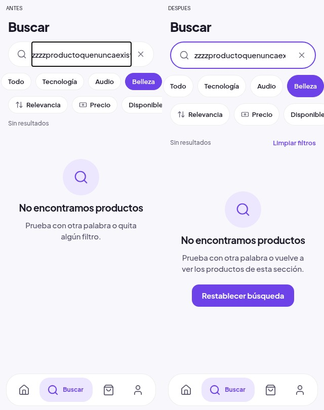
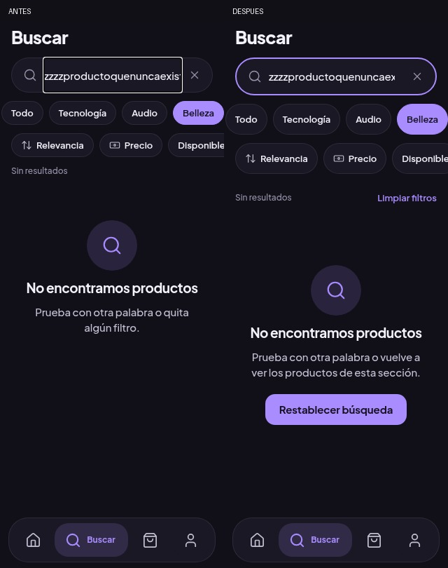

### Claro: pasos de la auditoría

| Paso | Antes | Después |
|---|---|---|
| 01 inicio | 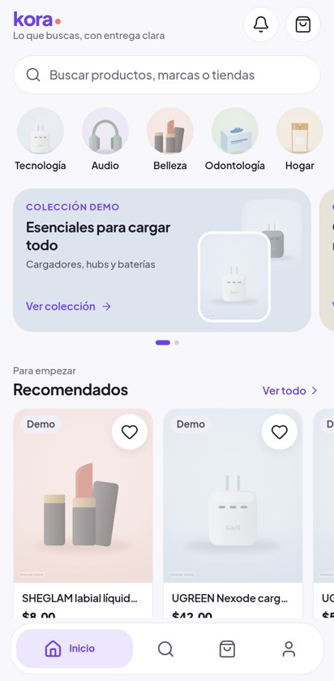 | 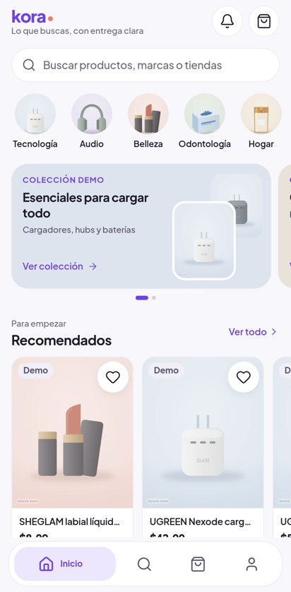 |
| 02 buscar | 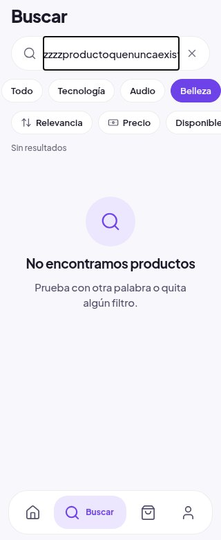 | 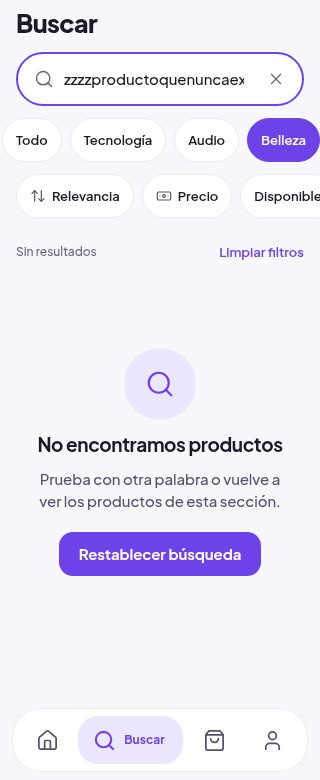 |
| 03 producto | 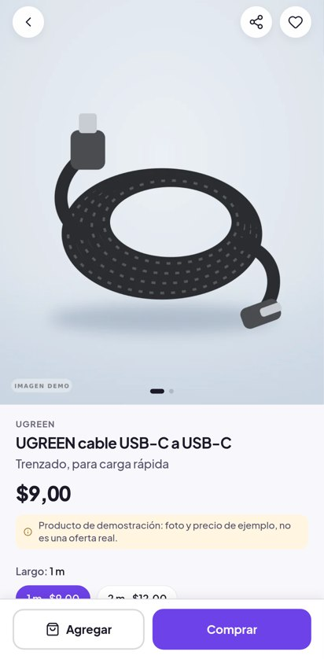 |  |
| 04 checkout | 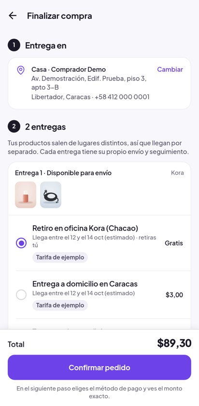 | 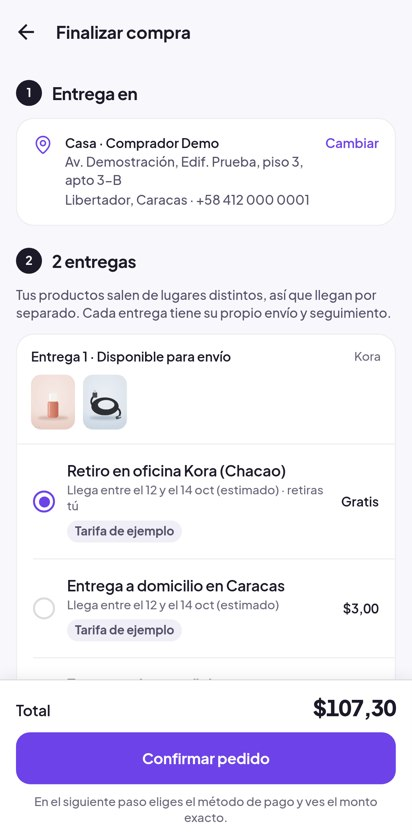 |
| 05 acceso | 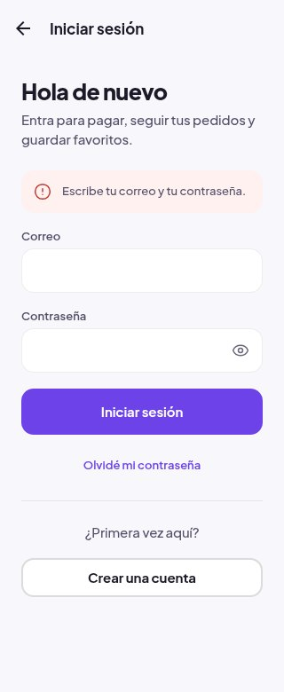 |  |
| 06 cuenta | 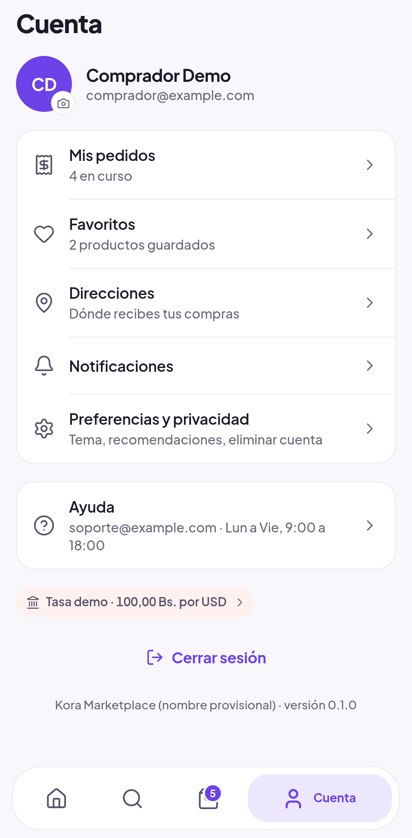 | 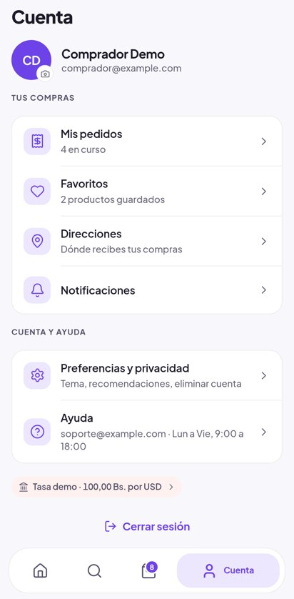 |
| 07 pedidos | 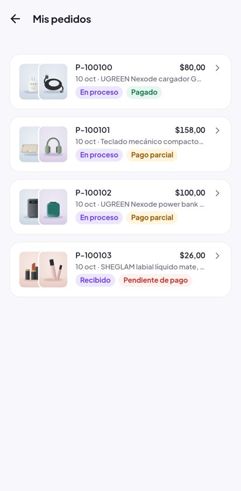 |  |
| 08 mi-tienda | 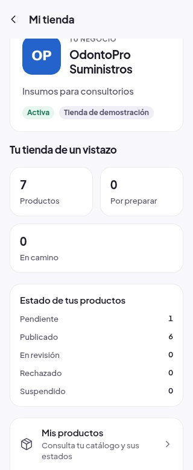 | 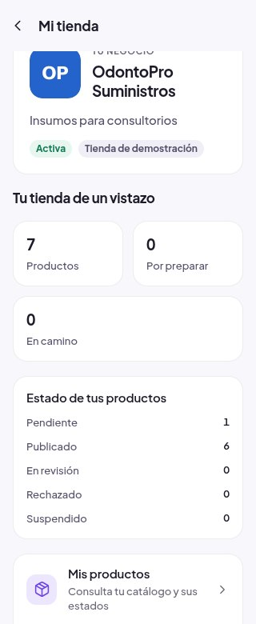 |

### Oscuro: pasos de la auditoría

| Paso | Antes | Después |
|---|---|---|
| 01 inicio | 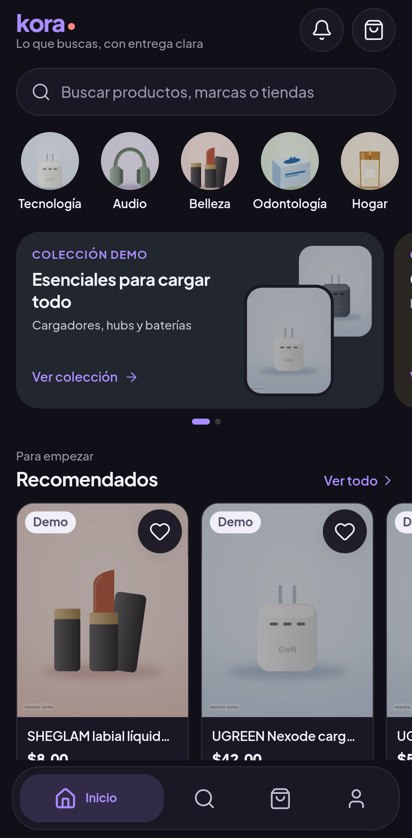 | 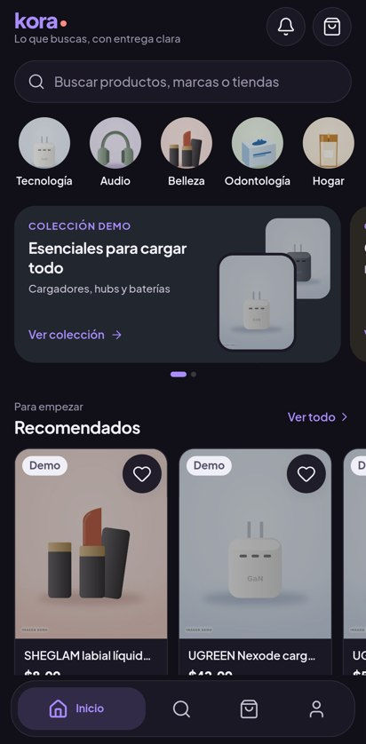 |
| 02 buscar | 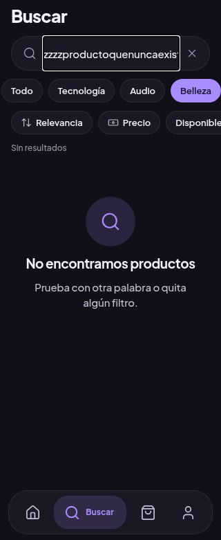 | 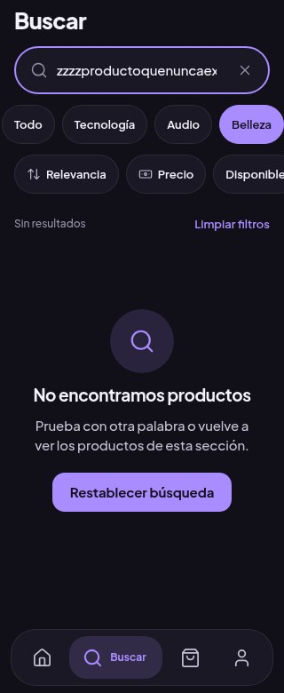 |
| 03 producto | 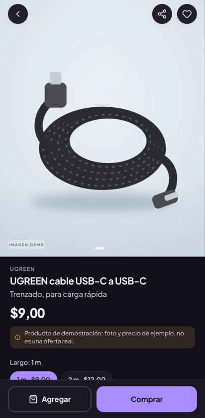 | 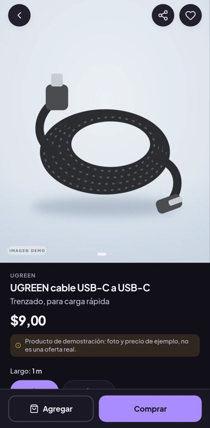 |
| 04 checkout | 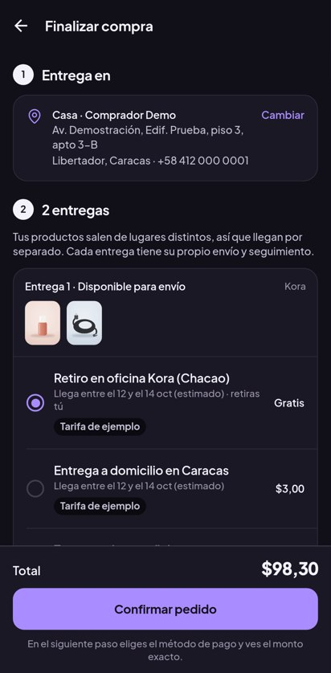 |  |
| 05 acceso | 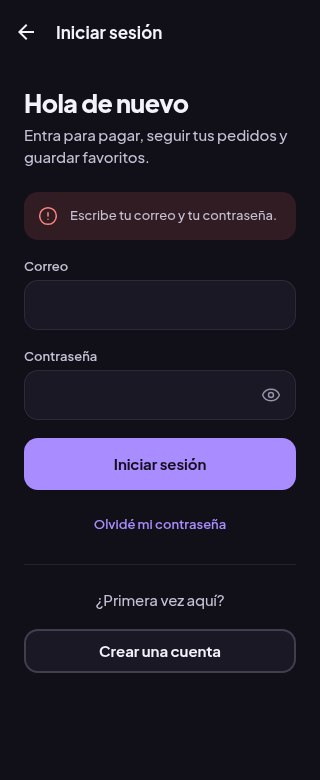 | 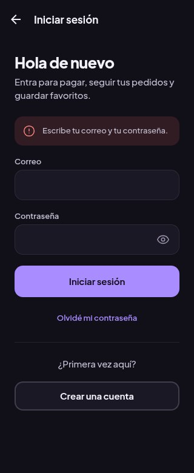 |
| 06 cuenta | 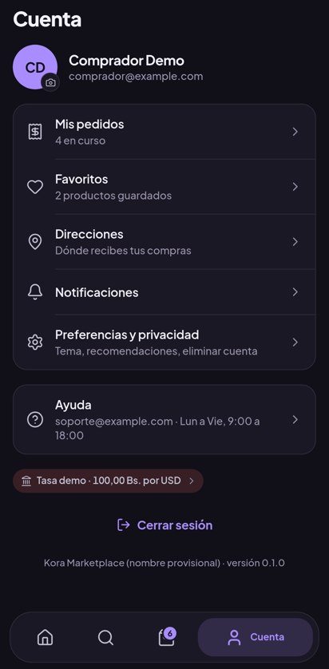 | 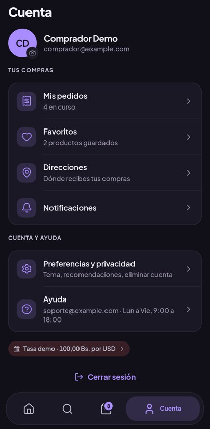 |
| 07 pedidos |  | 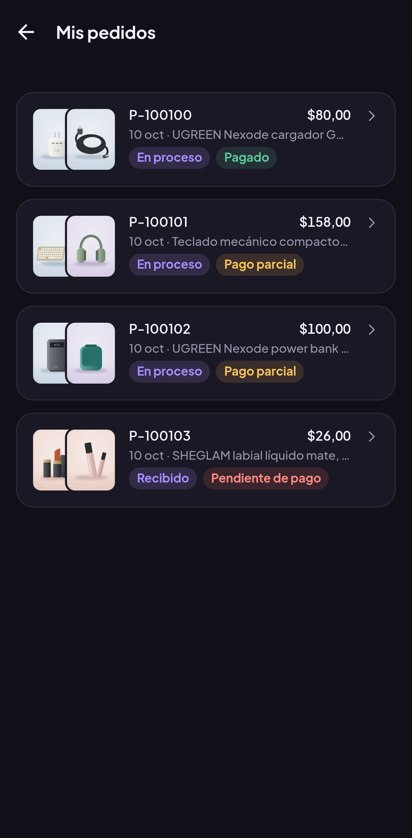 |
| 08 mi-tienda | 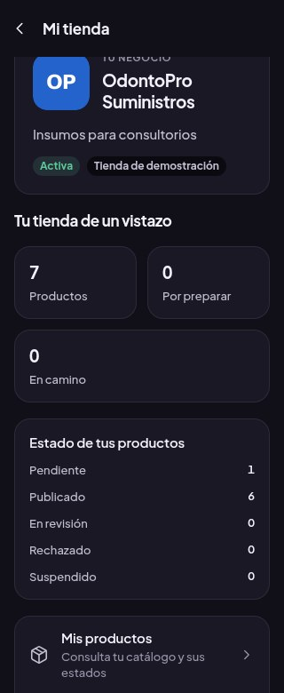 | 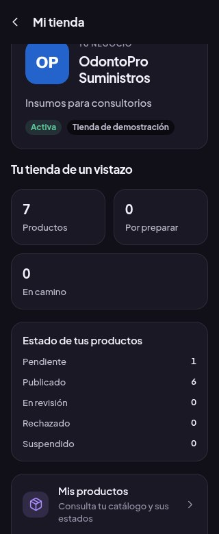 |

## Reproducir y retomar

Preparar entorno según ENTORNO.md, sin db:reset/test:db. Stack y runner/captura en la misma invocación
cloud; .local/global-ux contiene fuente/evidencia/logs. Si una fixture demo de pedido agotó stock, preparar
solo el dato local necesario y no atribuir ese error previo a UI a una regresión de diseño.

```bash
pnpm typecheck && pnpm lint
pnpm --filter @kora/core test
pnpm --filter @kora/app-e2e build:web
pnpm stack:start
pnpm --filter @kora/app-e2e exec playwright test -c playwright-app.config.ts
# Servir export web en 8089 antes de captura/auditoría.
node tools/design/screens.mjs .local/global-ux/after/light light
node tools/design/audit-global.mjs .local/global-ux/after/light light
node tools/design/accessibility.mjs /ruta/axe.min.js .local/global-ux
pnpm --filter @kora/mobile exec expo export --platform android --output-dir ../../.local/global-ux/android
```

axe-core 4.10.3 instalado SOLO en /tmp/hayazgo-design-audit para auditoría; ningún package/lock nativo
modificado. Logs .local/logs/global-ux-*, contrast.json/accessibility.json y DOM evidence.json ignorados.

## Publicación y límites

Autorización explícita de Oliver: publicar al terminar para revisar. Destino APK 5: Android preview,
runtime eb5ed1179b9c76c9c3cf27333aa48306728eb4ba; workflow debe pasar guard antes de publicar.
No generar APK. Validar visitante en Android: frente-a-v2/01-visitante, 06-global-ux, 05-mi-tienda-acceso,
ambos temas, sin registro/pedidos/pagos/favoritos remotos o escrituras de vendedor.
EAS preview 38291282048 **Success**, guard runtime aprobado; publicación completada 18:31:34Z.
Android revisión37 solicitada (3 flujos/2 temas), resultado pendiente; no afirmar recepción física.

Límites: TalkBack/fuentes/teclado/galería/rendimiento con sesión en Android físico requieren Oliver;
pruebas locales no certifican funcionamiento nativo completo. Mi tienda mantiene pendientes dos migraciones
remotas (MI_TIENDA_OPERATIVA.md), aquí no se desplegaron. BCV crítico separado, no tratado. Sin APIs/reglas
financieras/permisos/Supabase/Firebase/panel/iOS o identidad nativa cambiados. Solo publicación móvil autorizada.
No iniciar nuevas mejoras mientras Oliver revisa; retomar problemas concretos de este paquete.
