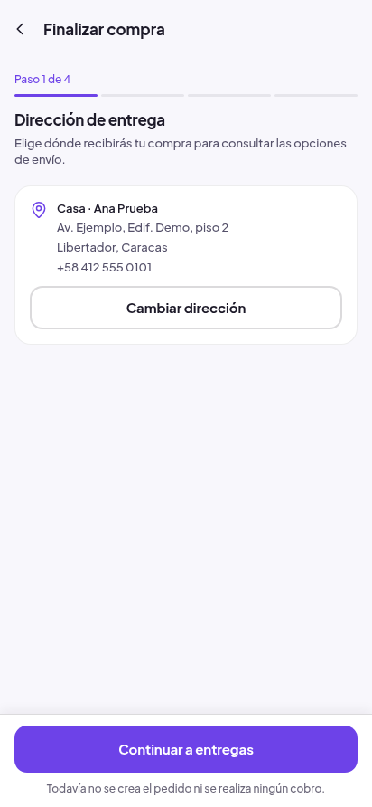
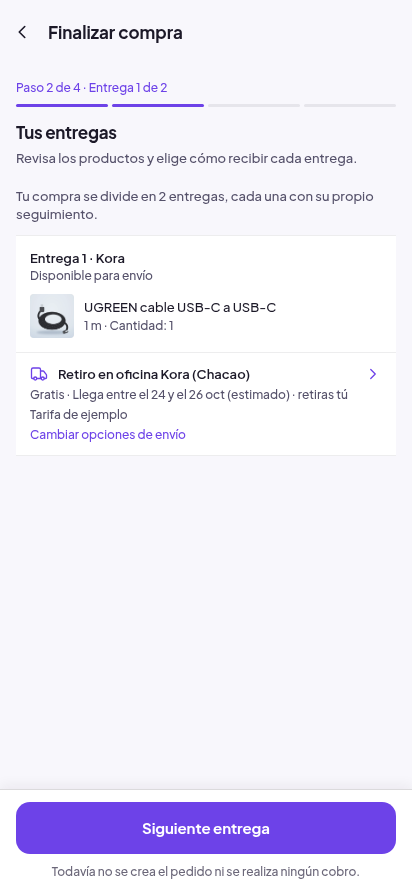
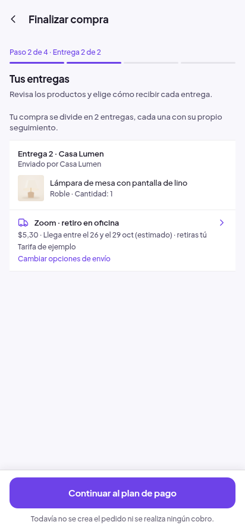
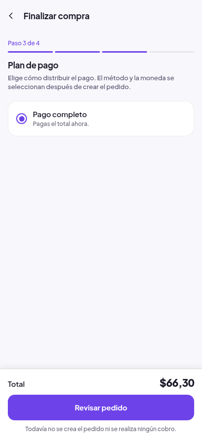
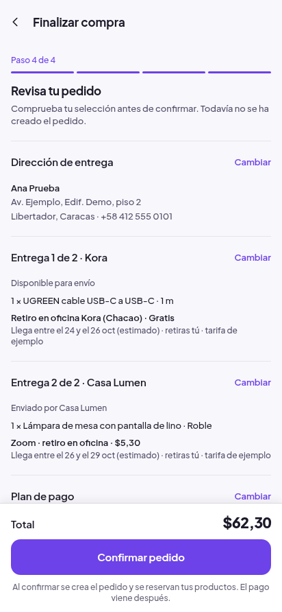

# Checkout progresivo: evidencia real

44 PNG originales sin edición: ocho anteriores y36 posteriores. Expo web/Chromium con el backend local existente. Mismos dos productos, tiendas, variantes, envíos y total62,30USD. No son capturas físicas Android. Texto ampliado mediante CSS1,6, separado de una prueba de escala del sistema. Hashes, procedencia y medidas en [evidencia.json](evidencia.json).

| Estado | Antes | Después |
|---|---|---|
| Entrada clara412 | [Página completa de decisiones](antes/light/checkout-412.png) | [Fase de dirección](despues/light/01-direccion-412.png) |
| Entrada oscura320 | [Página completa de decisiones](antes/dark/checkout-320.png) | [Fase de dirección](despues/dark/01-direccion-320.png) |
| Revisión clara412 | [Resumen anterior](antes/light/checkout-summary-412.png) | [Resumen final](despues/light/06-total-412.png) |
| Revisión oscura320 | [Resumen anterior](antes/dark/checkout-summary-320.png) | [Resumen final](despues/dark/06-total-320.png) |

Las cinco vistas del recorrido (cuatro fases; dos entregas dentro del paso2):

Los archivos `font-160-*` cubren las mismas fases y el total a320px en ambos temas. El total se desplazó hasta quedar, por medición, encima de la barra; no se recortaron ni compusieron capturas.

Recepción Android real: [16JPG y manifiesto](native/evidencia.json), [4/4 recorridos](native/resumen.md) y [run/source](native/LEEME.md). Son derivados de CI; visitante normal/OS1,6 en ambos temas, no la compra autenticada física. OTA `01a16be3-4827-77bc-bcf4-0f28d5895325`.
