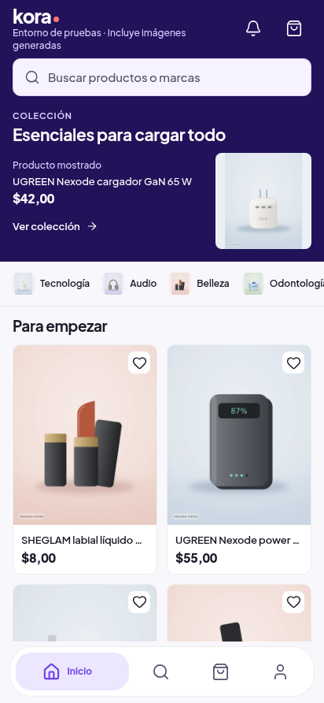
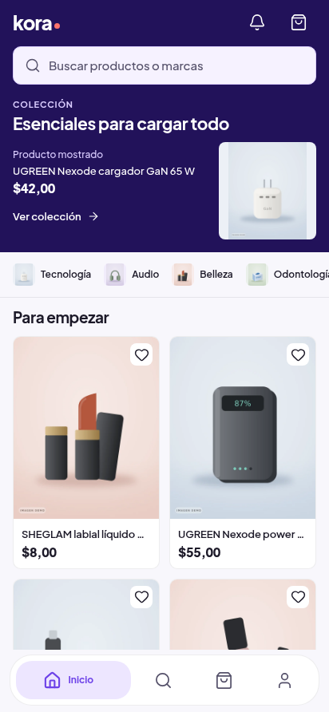

# Móvil ·evidencia26oct2026

- Carrito/tiendas:40anteriores+40posteriores normales,320/412 claro/oscuro y CSS1/1,6; ocho estados de error finales.16DTO comparables sin diferencias comerciales. La matriz inicial se capturó sin habilitar presentación privada en el anterior; sólo se usa para geometría/conteos/importe, no para demostrar retirada de avisos.
- Voz comercial:16PNG/ocho pares reales, privado antes743bb7c8101 vs después8103; mismos DTO locales y UGREENNexode65W en Inicio/Buscar/ficha. IdentidadElectricViolet conservada. Los avisosUI desaparecen; no se modifican los píxeles de las imágenes. Los UUID del seedlocal difieren de los remotos del registro38: pueden verse ilustraciones antiguas con texto incrustado; **estos pares no acreditan fotografías remotas renovadas**.
- Galería:14PNG, seis casos en ambos temas con DTO/Storage interceptados localmente y bytes versionados. Rutas propias se conservan; desplazamiento real actualiza página/créditos; fallo de override retira atribución y variante sana recupera la correcta. Hoja accesible por Enter/Escape y botones. No auth/mutaciones remotas.
- Tiendas:8PNG de Kora/Patitas, descripción/catálogo/regreso en ambos temas, dos pruebas sobre8103. El scope de description se corrigió antes de aprobar tipos/export; las13pruebas anteriores8102 no se repitieron porque ese movimiento sólo afectaStoreHeader.

15casosUI distintos:7carrito/reputación +6galería/comercial +2tiendas.25unitarias de política/galería/textos; tipos/lint monorepo y AndroidHermes verdes. No nuevas fotos en este lote. Los originales se copian byte por byte, con hashes en manifest.json. Chromium no acredita Android físico, fuenteOS niTalkBack. Publicación/recepción nativa se añade por separado.

## Comparación de Inicio

Mismo DTO local,412px, claro. Antes y después conservan el mismo UGREEN65W; las ilustraciones de Storage no se renuevan aquí.

| Antes | Después |
|---|---|
|  |  |

[Ocho comparaciones completas](voz-comercial/index.html). Galería y créditos reales del registro privado se comprueban por los seis casos específicos y después en Android, no mediante estas ilustraciones locales.
